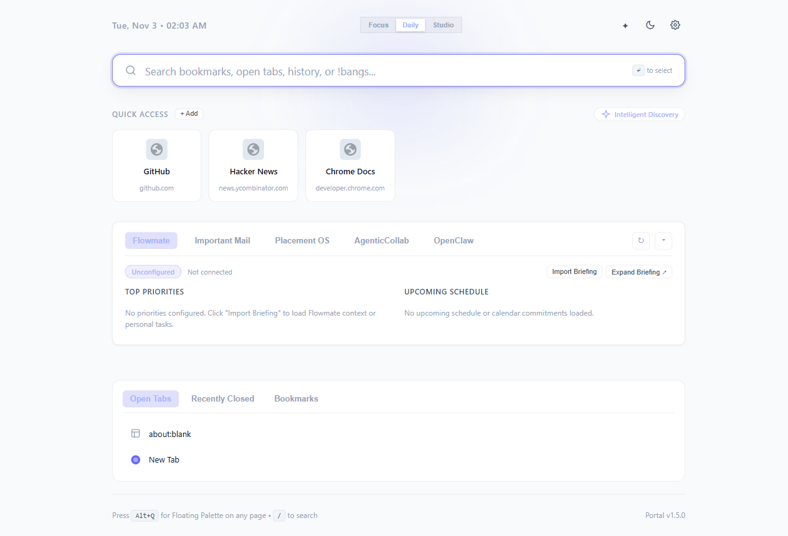

# Portal ✦ Intelligent Chrome Homepage & Browser Launcher

> An intelligent, beautiful, ultra-lightweight Chrome homepage and floating command palette designed to elevate daily browsing, surface Flowmate personal context, and orchestrate OpenClaw automation without slowing down your browser.



## Core Capabilities in v1.5.0

- **Modular Personal Command Shell & Layout Presets**:
  - `Focus`: Minimalist launcher with search box, live clock, and personal pinned shortcuts. Distraction-free.
  - `Daily`: Balanced homepage with search, quick access shortcuts, and morning briefing projection.
  - `Studio`: Full modular command environment with dedicated panels for Flowmate personal context, Placement OS career milestones, AgenticCollab conversation archives, and OpenClaw automation.
- **Chrome Prompt API Safety Attestation**: Passes `{ expectedInputs, expectedOutputs: [{ type: 'text', languages: ['en'] }] }` to Chrome's built-in Gemini Nano / Prompt API, silencing output language console warnings on modern Chrome (134-136+).
- **Clean Quick Access & Zero Clutter**: Removed repeated `FREQUENT` badges from cards; badges are reserved strictly for genuine AI outputs (`✦ AI`), while visit counts and provenance are surfaced cleanly on hover tooltip.
- **Unified Add Shortcut Modal & Discovery Destinations**: Direct manual entry (Title + URL) at the top with auto-title inference, paired with an interactive 1-click candidate destination picker below categorizing Open Tabs, Top Bookmarks, Frequent History, and Saved Sessions.
- **Deep-Path History Clustering**: Recognizes deep web paths (`chatgpt.com/c/:id`, `github.com/:owner/:repo`, `docs.google.com/document/d/:id`, `youtube.com/watch?v=:id`), prevents collapsing distinct projects into domain buckets, and cleans out generic titles ("Home", "Sign in", "Overview").
- **Direct URL & Domain Navigation on Paste**: Pasted URLs, complete protocols (`https://`, `http://`, `file:///`, `chrome://`), `localhost(:port)?`, IPv4 addresses (`127.0.0.1:port`), and valid TLD domains (`github.com`, `vite.dev`) navigate directly on Enter with score 5000 (`NAVIGATE`). Pasted URLs NEVER fall back to Google searches.
- **Synchronous Intent Resolver (<1ms)**: Deterministic, pure evaluation of current input executed immediately on Enter even before asynchronous suggestions return.
- **Alt+Q MRU Tab Switcher (`Alt+Q → Enter`)**: Service worker tracks real-time MRU tab activation history. Summoning the floating palette on empty query puts the previously active tab at index 0 with badge `SWITCH TAB`. Pressing `Alt+Q → Enter` instantly returns to your previous tab.
- **Alt+Q / `/` Key Focus Handoff**: Pressing `Alt+Q` while on New Tab focuses and selects the search input rather than opening a redundant page. Pressing `/` anywhere on the New Tab page instantly focuses search.
- **Leak-Free Floating Palette Teardown**: Closing or toggling off the launcher cleanly unbinds all window keydown listeners, cancels debouncers, restores previous page focus, and unmounts the Shadow DOM container.
- **Personal Shortcut Management & Ownership**: Click the edit button (✏️) on any pinned shortcut to rename titles, edit URLs, or delete them. Click "+ Add" in Quick Access to pin new custom destinations.
- **Recently Closed Session Restoration**: Contextual section includes a "Recently Closed" tab showing closed tabs and full windows with 1-click restoration via `chrome.sessions.restore()`.
- **Themes, Accents & Density Customization**:
  - Themes: `system`, `dark`, `light`, and `midnight` (pure OLED black `#000000`).
  - Accents: `violet` (default), `blue` (electric blue), `emerald`, `amber`, and `rose`.
  - Density: `compact` (tighter cards & font scale), `comfortable` (balanced default), and `relaxed`.
- **Free Cross-Device Release Delivery with Rollback Protection (`scripts/sync-release.ps1`)**: Zero-cost Git/PowerShell sync script pulling tested releases to the ThinkBook workstation, verifying build integrity, generating atomic `build-metadata.json`, safely backing up `dist.backup/`, and supporting `-Rollback`.
- **Ultra-Lightweight Homepage**: Replaces Chrome's New Tab with an instantaneous dashboard (**47.3ms DOM interactive, 3.79MB JS heap**, 0% idle CPU, **ZERO unsolicited network requests**).
- **Personal Intelligence Briefing with User Import**: Displays honest unconfigured states when sources are offline; provides an **Import Briefing** workflow supporting Markdown task lists (`- [ ] task`) and JSON.
- **Saved Browsing Session Workspaces**: Snapshot open tabs into named sessions; restore specific sessions accurately by `sessionId` without default `sessions[0]` hijacking. General omni-search matches sessions by workspace name and tab titles.
- **Audio Tab Control & Filtering**: Type `@audio` (or `@sound`, `@music`) to isolate playing media tabs. Audio tabs display a prominent `AUDIO 🔊` badge and priority boost; control them via `/switch-to-audio-tab` or `/mute-all-audio-tabs`.
- **Unified `@` Prefix Grammar**:
  - `@gh` (GitHub), `@yt` (YouTube), `@w` (Wikipedia), `@so` (Stack Overflow), `@r` (Reddit), `@npm` (npm), `@g` (Google), `@ddg` (DuckDuckGo), `@x` (X/Twitter). Legacy `!` bangs remain supported.
  - `@tabs`, `@bookmarks`, `@history`, `@audio`.
  - `/` commands (`/sleep`, `/theme`, `/clip`, `/save-session`).
- **Inactivity-Gated Tab Memory Suspender**: `/sleep` discards non-active background tabs older than 10 minutes via `chrome.tabs.discard()`; `/sleep-all` forces immediate memory reclamation.
- **Zen / Focus Mode (`Z`)**: Press `Z` or click the Zen button to toggle an ultra-minimalist view that hides non-essential widgets.
- **Harmonious Omnibox**: Preserves native Chrome address bar behavior while offering an optional `p <query>` omnibox shortcut.
- **Zero Telemetry & Strict Privacy**: 100% local-first. Zero external API calls, zero analytics, zero remote servers.

---

## Performance Against Native Chrome Baseline

Measured on a Lenovo IdeaPad (Windows 11, Chrome 156):

| Metric | Native Chrome NTP Baseline | Portal Target Budget | Portal v1.4.0 Result | Status |
|---|---|---|---|---|
| **DOM Interactive** | 18.30 ms | < 100 ms | **47.30 ms** | **PASSED** |
| **DOM Content Loaded** | 18.40 ms | < 120 ms | **73.80 ms** | **PASSED** |
| **Warm Navigation Average** | ~72.90 ms | < 250 ms | **146.02 ms** (fastest 90.03 ms) | **PASSED** |
| **Active JS Heap** | ~28.00 MB | < 38.00 MB | **3.79 MB** | **EXCEEDED** (< 1/7 native) |
| **Keypress Autocomplete Latency** | < 16 ms | < 60 ms | **52.79 ms** | **PASSED** |
| **Launcher Summon Latency** | N/A | < 150 ms | **104.64 ms** | **PASSED** |
| **Cold NTP Network Requests** | 0 external | 0 external / 0 loopback | **0 requests** | **PASSED** |
| **Extension Bundle Size** | N/A | < 250 KB | **96.8 KB** (total dist) | **EXCEEDED** |
| **Idle Service Worker CPU** | 0% | 0% | **0%** | **PASSED** (Suspends cleanly) |

See [`docs/PERFORMANCE.md`](docs/PERFORMANCE.md) for full benchmark methodology.

---

## Installation & Cross-Device Sync

### 1. Install Unpacked in Chrome (Development or First-Time)
1. Open Google Chrome and navigate to `chrome://extensions`.
2. Toggle on **Developer mode** in the top right corner.
3. Click **Load unpacked**.
4. Select the `dist` folder located in this repository (`Portal/dist`).
5. Open a new tab (`Ctrl+T`) to immediately experience Portal, or press `Alt+Q` on any page!

### 2. Free ThinkBook Workstation Sync (No Chrome Web Store)
On your secondary or primary workstation (ThinkBook), simply run:
```powershell
.\scripts\sync-release.ps1 -Branch "feature/portal-next-level"
```
This automatically pulls the latest verified commits, builds the extension, verifies TypeScript integrity, generates atomic `dist/build-metadata.json`, and guides a safe extension reload without clearing your settings or custom shortcuts.

### 3. Development & Automated Testing
```powershell
# Install dependencies
npm install

# Typecheck codebase (strict mode)
npm run typecheck

# Build production extension (dist/) & generate metadata
npm run build

# Run full automated test suite (53 tests: 27 unit + 26 real Playwright browser E2E tests)
npm test

# Run empirical performance benchmark
npm run benchmark
```

# Run real browser performance benchmark
npm run benchmark
```

---

## Architecture & Verification
- [`docs/BUILD_STATE.md`](docs/BUILD_STATE.md) — Implementation status, audited fixes, and v1.3.1 source integrity corrections.
- [`docs/ACCEPTANCE.md`](docs/ACCEPTANCE.md) — Complete 44-item verification matrix across real browser workflows and unit tests.
- [`docs/DECISIONS.md`](docs/DECISIONS.md) — Architectural decision log, trade-off rationale, and DEC-020 through DEC-023.
- [`docs/PERFORMANCE.md`](docs/PERFORMANCE.md) — Detailed latency, memory, network, and startup measurements.
- [`docs/DEVICE_TOPOLOGY.md`](docs/DEVICE_TOPOLOGY.md) — Multi-device orchestration topology, IdeaPad coordinator, ThinkBook worker node, security boundaries, and execution classes.
